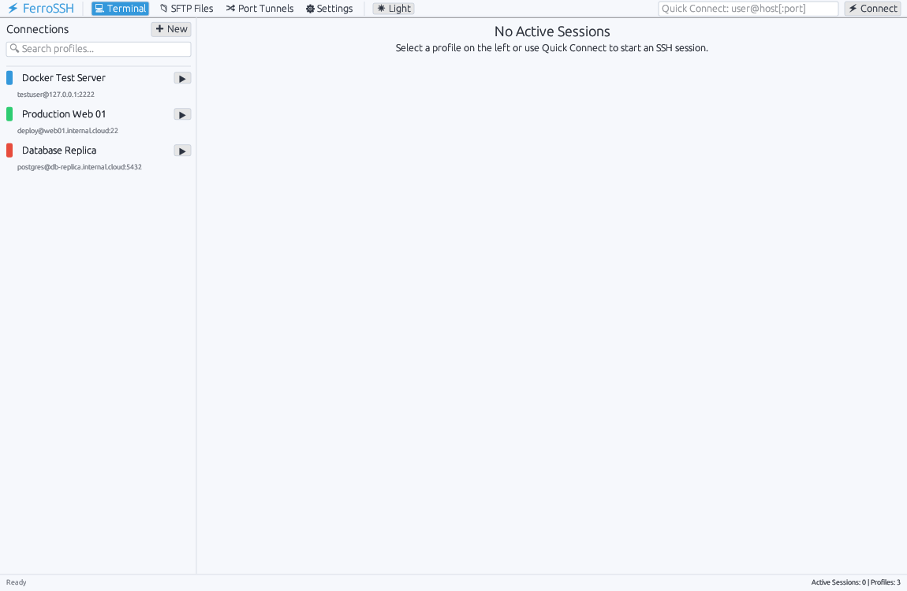

# FerroSSH ⚡

[](https://github.com/mottipython/ferro-ssh/actions/workflows/ci.yml)
[](SECURITY.md)
[](tests/fuzz_test.rs)
[](LICENSE)

A high-performance graphical SSH client for Linux, Windows, and macOS written in Rust with `egui` (`eframe`). Built with native PTY terminal emulation, OpenSSH transport delegation, Trust-On-First-Use (TOFU) host key verification, in-memory credential zeroization, and an integrated SysAdmin Command Toolbox.


---

## 📸 Interface Tour

| Feature | Interface Preview |
|---|---|
| **Cryptographic Host Key Verification (TOFU) & Docked Command Toolbox**<br>Intercepts unrecognized host keys, presenting full SHA-256 fingerprints with options to *Accept & Save*, *Accept Once*, or *Abort*. The right sidebar features over 35 quick sysadmin commands. |  |
| **Connection Manager & Profiles**<br>Color-coded server badges, group organization, search filter, and instant Quick Connect. |  |
| **SSH Port Forwarding & Tunnels**<br>Manage local `-L` port forwarding rules for remote databases, metrics dashboards, and web services. |  |
| **Integrated Remote SFTP Explorer**<br>Fast remote file management, directory navigation, file sizes, and native upload/download pickers. |  |
| **Settings, Appearance & Key Discovery**<br>Dynamic font sizing, automated `~/.ssh/` key discovery (`id_ed25519`, `id_rsa`), and TOFU configuration. |  |
| **Adaptive Theme (Light & Dark Mode)**<br>Automatically matches system OS dark or light mode in real time, with high-contrast terminal styling and 1-click manual override. |  |

---

## 🛡️ Security Architecture & Engineering Safeguards

FerroSSH adopts a transparent, defense-in-depth security model rather than making sweeping claims of absolute security. Complete technical specifications, explicit threat boundaries, and vulnerability disclosure policies are detailed in [SECURITY.md](SECURITY.md).

- **Audited Transport Delegation (OpenSSH):** FerroSSH avoids the hazards of implementing a custom cryptographic protocol. All transport encryption, key exchange (Curve25519, ECDH), and ciphers (ChaCha20-Poly1305, AES-GCM) are delegated directly to the host operating system's battle-tested OpenSSH client.
- **Direct Process Invocation:** Commands (`ssh`, `scp`) are invoked directly via OS system calls (`execve`) with discrete argument vectors, never piped through `/bin/sh` or intermediate command interpreters.
- **Option Injection Mitigation:** All dynamic host and user specifications are preceded by the POSIX `--` delimiter, preventing malicious inputs from injecting command-line flags (e.g., `-oProxyCommand=...`).
- **Remote Shell Injection Guard:** Remote commands (such as directory listings in the SFTP browser) sanitize path arguments using strict POSIX single-quote encapsulation (`shell_quote`), preventing remote shell metacharacter execution.
- **In-Memory Credential Zeroization:** Passwords and sensitive input buffers are encapsulated in `SecureSecret` with `zeroize::ZeroizeOnDrop` and explicitly wiped from RAM with `.zeroize()` immediately upon transmission to the PTY.
- **Log & Trace Redaction:** Secret types override `std::fmt::Debug` to output `SecureSecret([REDACTED])`, preventing credential leakage into logs or crash dumps.
- **Trust-On-First-Use (TOFU) Verification:** Unknown host fingerprints are intercepted and presented in an interactive dialog showing full SHA-256 fingerprints before any connection or authentication proceeds.
- **Zero Telemetry & Clean-Slate Privacy:** No network requests are made outside user-initiated SSH sessions. Fresh installs are completely unpopulated, containing no preloaded third-party hosts or tunnels.
- **Continuous Adversarial Fuzzing:** Core parsers (VTE escape sequences, ANSI bombs, Quick Connect strings, SFTP output, prompt extraction, and known_hosts) are hardened with a dedicated multi-threaded mutation fuzzer (`fuzz-runner`) validated through 1,000,000+ adversarial iterations with zero crashes.
- **Dependency Audit:** Regular automated dependency scanning ensures 0 known vulnerabilities (CVEs) across the Rust crate tree.

---

## Features

- **🌓 Dynamic System Theme Support (Light & Dark Mode):**
  - Automatically matches OS light or dark mode settings in real-time across Linux, macOS, and Windows.
  - Manual override selector in Settings (`System (Auto)`, `Dark Mode`, `Light Mode`) and instant 1-click cycle button in the top navigation bar.
  - High-contrast terminal rendering with theme-aware background, foreground text, and cursor styling.
- **🛡️ Cryptographic Host Key Verification (TOFU):**
  - Intercepts unrecognized SSH host fingerprints and presents a Trust-On-First-Use confirmation modal.
  - Options to **Accept & Save to `~/.ssh/known_hosts`**, **Accept Once (Session Only)**, or **Reject & Abort**.
  - Shows key type (`ED25519`, `RSA`, `ECDSA`) and full SHA-256 fingerprint.
- **🔐 Memory-Scrubbed Secret Handling:**
  - Secure password authentication modal with masked fields.
  - In-memory credentials wrapped in `zeroize::Zeroize` to scrub passwords from RAM immediately upon dispatch.
  - Redacted debug representations to avoid secret leakage in logs.
- **📟 Embedded Multi-Session Terminal:**
  - Real PTY terminal emulator powered by `portable-pty` and `vte`.
  - ANSI 16-color and 256-color palette support, bold and underline styling.
  - Multi-tab session manager with independent terminal buffers and scrollback.
  - Full keyboard mapping including arrow keys, function keys, and control sequences (`Ctrl+C`, `Ctrl+D`, `Ctrl+Z`, `Ctrl+L`).
- **🗂️ Connection Profile Manager:**
  - Quick Connect bar (`user@host[:port]`).
  - Saved profiles with color badges, groups, notes, and port configuration.
  - Auto-discovery of existing private keys in `~/.ssh/` (`id_ed25519`, `id_rsa`, `id_ecdsa`).
  - Anonymized clean slate: fresh installs start with zero preconfigured servers.
- **📁 Integrated SFTP Remote File Browser:**
  - Browse remote directories with permissions, file sizes, and modification dates.
  - Shell-escaped path querying and native file dialogs for uploading and downloading files.
- **🧰 Command Toolbox & Snippets (F2):**
  - Over 35 categorized sysadmin diagnostics across System, Disk, Network, Docker, Services, and Security.
  - One-click `▶ Run` (direct execution), `✏ Insert` (paste without Enter for editing arguments), and `📋 Copy`.
  - Add and manage persistent custom commands (`~/.config/ferro-ssh/toolbox.json`).
- **🔀 Port Forwarding & Tunnel Manager:**
  - Configure and manage local port forwards (`-L local_port:remote_host:remote_port`).
- **🪟 Cross-Platform Support:**
  - Native builds and releases for **Linux** (Fedora, Ubuntu, Arch), **Windows** (`.exe`), and **macOS** (Apple Silicon `arm64` & Intel `x86_64`).

---

## Building and Running

### Linux (Fedora / Ubuntu / Arch)
```bash
cargo build --release
```
The binary will be located at `target/release/ferro-ssh`.

### Windows (.exe)
Cross-compile with the provided Docker builder or run natively on Windows:
```bash
docker build -f build-windows.Dockerfile -t ferro-windows-builder .
docker run --rm -v $(pwd):/build ferro-windows-builder cargo build --target x86_64-pc-windows-gnu --release
```
The executable will be located at `target/x86_64-pc-windows-gnu/release/ferro-ssh.exe`.

### macOS (Apple Silicon M1/M2/M3 & Intel)
Cross-compile directly with `cargo-zigbuild` or build natively on macOS:

```bash
# Apple Silicon (M1/M2/M3/M4)
docker run --rm -v $(pwd):/io -w /io messense/cargo-zigbuild cargo zigbuild --release --target aarch64-apple-darwin

# Intel Macs
docker run --rm -v $(pwd):/io -w /io messense/cargo-zigbuild cargo zigbuild --release --target x86_64-apple-darwin
```
The binaries will be located at:
- `target/aarch64-apple-darwin/release/ferro-ssh`
- `target/x86_64-apple-darwin/release/ferro-ssh`

### Fuzz Testing (Stress & Mutation Testing)
FerroSSH features both a deterministic integration fuzz suite and an evolutionary multi-threaded mutation engine:

```bash
# Run the integration fuzz test suite
cargo test --test fuzz_test

# Run the multi-threaded mutation fuzzer (1,000,000 iterations across all CPU cores)
cargo run --bin fuzz-runner --release -- --duration 15 --iterations 1000000
```

---

## CI / CD
GitHub Actions automatically builds release artifacts on every push for:
- Linux (`ferro-ssh-linux-x86_64`)
- Windows (`ferro-ssh-windows-x86_64.exe`)
- macOS Apple Silicon (`ferro-ssh-macos-arm64`)
- macOS Intel (`ferro-ssh-macos-x86_64`)
