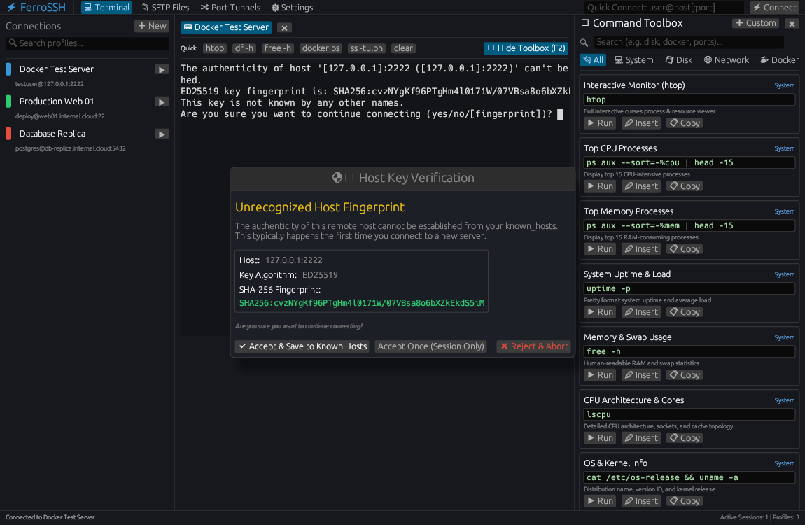
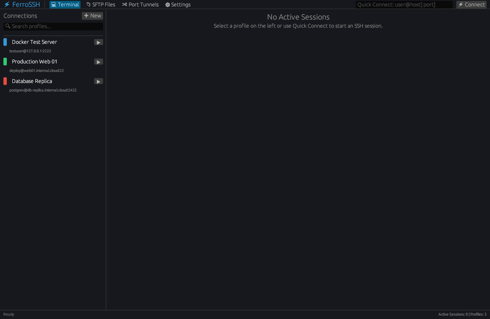
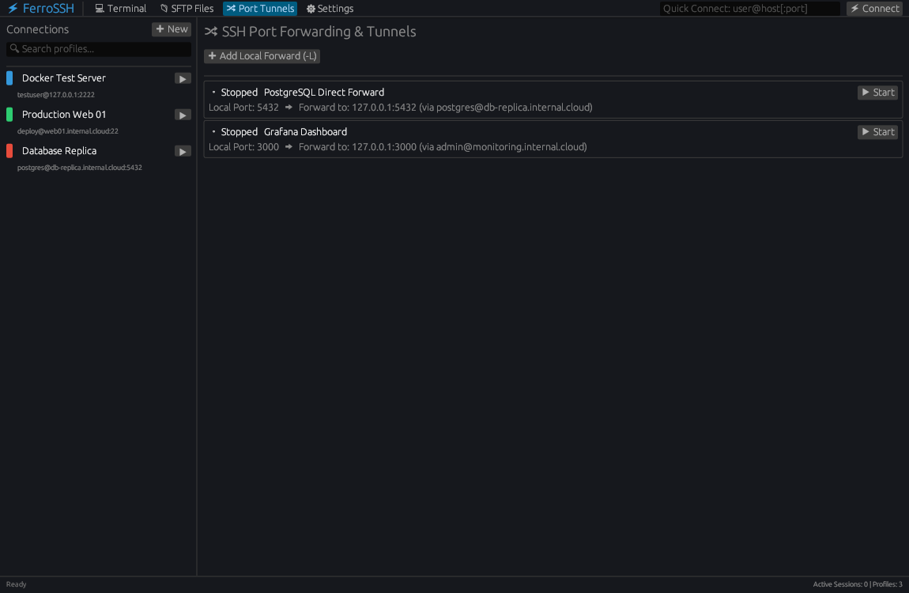
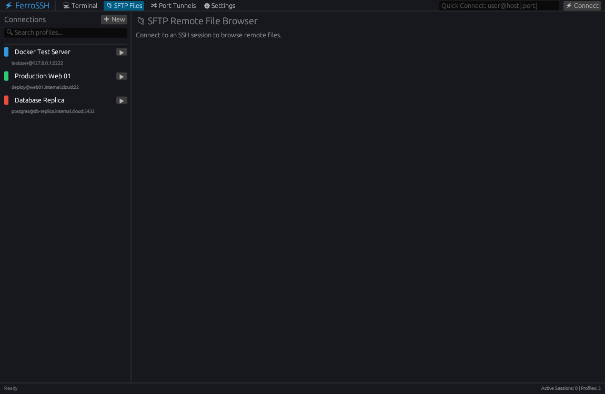
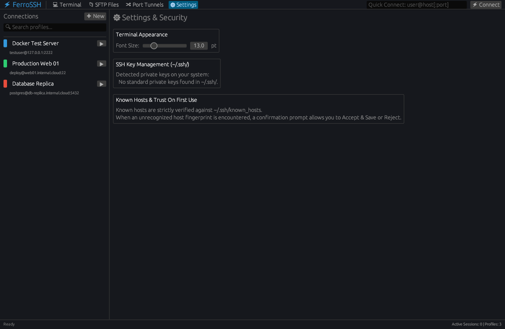

# FerroSSH ⚡

A secure, high-performance, and feature-rich graphical SSH client written in Rust with `egui` (`eframe`). Built with native PTY terminal emulation, cryptographic Trust-On-First-Use (TOFU) host key verification, memory-scrubbed password protection, and a dockable SysAdmin Command Toolbox.



---

## 📸 Interface Tour

| Feature | Interface Preview |
|---|---|
| **Cryptographic Host Key Verification (TOFU) & Docked Command Toolbox**<br>Intercepts unrecognized host keys, presenting full SHA-256 fingerprints with options to *Accept & Save*, *Accept Once*, or *Abort*. The right sidebar features over 35 quick sysadmin commands. |  |
| **Connection Manager & Profiles**<br>Color-coded server badges, group organization, search filter, and instant Quick Connect. |  |
| **SSH Port Forwarding & Tunnels**<br>Manage local `-L` port forwarding rules for remote databases, metrics dashboards, and web services. |  |
| **Integrated Remote SFTP Explorer**<br>Fast remote file management, directory navigation, file sizes, and native upload/download pickers. |  |
| **Settings, Appearance & Key Security**<br>Dynamic font sizing, automated `~/.ssh/` key discovery (`id_ed25519`, `id_rsa`), and TOFU configuration. |  |

---

## Features

- **🛡️ Cryptographic Host Key Verification (TOFU):**
  - Intercepts unrecognized SSH host fingerprints and presents a Trust-On-First-Use confirmation modal.
  - Options to **Accept & Save to `~/.ssh/known_hosts`**, **Accept Once (Session Only)**, or **Reject & Abort**.
  - Shows key type (`ED25519`, `RSA`, `ECDSA`) and full SHA-256 fingerprint.
- **🔐 Password & Secret Security:**
  - Secure password authentication modal with masked fields.
  - Credentials in memory are wrapped in `zeroize::Zeroize` to ensure passwords and passphrases are securely scrubbed from RAM immediately upon release.
  - Redacted debug representations to avoid secret leakage in logs.
- **📟 Embedded Multi-Session Terminal:**
  - Real PTY terminal emulator powered by `portable-pty` and `vte`.
  - ANSI 16-color and 256-color palette support, bold and underline styling.
  - Multi-tab session manager with independent terminal buffers and scrollback.
  - Full keyboard mapping including arrow keys, function keys, and control sequences (`Ctrl+C`, `Ctrl+D`, `Ctrl+Z`, `Ctrl+L`).
- **🗂️ Connection Profile Manager:**
  - Quick Connect bar (`user@host[:port]`).
  - Saved profiles with color badges, groups, notes, and port configuration.
  - Auto-discovery of existing private keys in `~/.ssh/` (`id_ed25519`, `id_rsa`, `id_ecdsa`).
- **📁 Integrated SFTP Remote File Browser:**
  - Browse remote directories with permissions, file sizes, and modification dates.
  - Native file dialogs for uploading and downloading files.
- **🧰 Command Toolbox & Snippets (F2):**
  - Over 35 categorized sysadmin diagnostics across System, Disk, Network, Docker, Services, and Security.
  - One-click `▶ Run` (direct execution), `✏ Insert` (paste without Enter for editing arguments), and `📋 Copy`.
  - Add and manage persistent custom commands (`~/.config/ferro-ssh/toolbox.json`).
- **🔀 Port Forwarding & Tunnel Manager:**
  - Configure and manage local port forwards (`-L local_port:remote_host:remote_port`).
- **🪟 Cross-Platform:**
  - Native builds and releases for **Linux** (Fedora, Ubuntu, Arch), **Windows** (`.exe`), and **macOS** (Apple Silicon `arm64` & Intel `x86_64`).
- **✅ Snyk Security Validated:**
  - Clean audit passed: 0 security vulnerabilities.

---

## Building and Running

### Linux (Fedora / Ubuntu / Arch)
```bash
cargo build --release
```
The binary will be located at `target/release/ferro-ssh`.

### Windows (.exe)
Cross-compile with the provided Docker builder or run natively on Windows:
```bash
docker build -f build-windows.Dockerfile -t ferro-windows-builder .
docker run --rm -v $(pwd):/build ferro-windows-builder cargo build --target x86_64-pc-windows-gnu --release
```
The executable will be located at `target/x86_64-pc-windows-gnu/release/ferro-ssh.exe`.

### macOS (Apple Silicon M1/M2/M3 & Intel)
Cross-compile directly with `cargo-zigbuild` or build natively on macOS:

```bash
# Apple Silicon (M1/M2/M3/M4)
docker run --rm -v $(pwd):/io -w /io messense/cargo-zigbuild cargo zigbuild --release --target aarch64-apple-darwin

# Intel Macs
docker run --rm -v $(pwd):/io -w /io messense/cargo-zigbuild cargo zigbuild --release --target x86_64-apple-darwin
```
The binaries will be located at:
- `target/aarch64-apple-darwin/release/ferro-ssh`
- `target/x86_64-apple-darwin/release/ferro-ssh`

---

## CI / CD
GitHub Actions automatically builds release artifacts on every push for:
- Linux (`ferro-ssh-linux-x86_64`)
- Windows (`ferro-ssh-windows-x86_64.exe`)
- macOS Apple Silicon (`ferro-ssh-macos-arm64`)
- macOS Intel (`ferro-ssh-macos-x86_64`)
